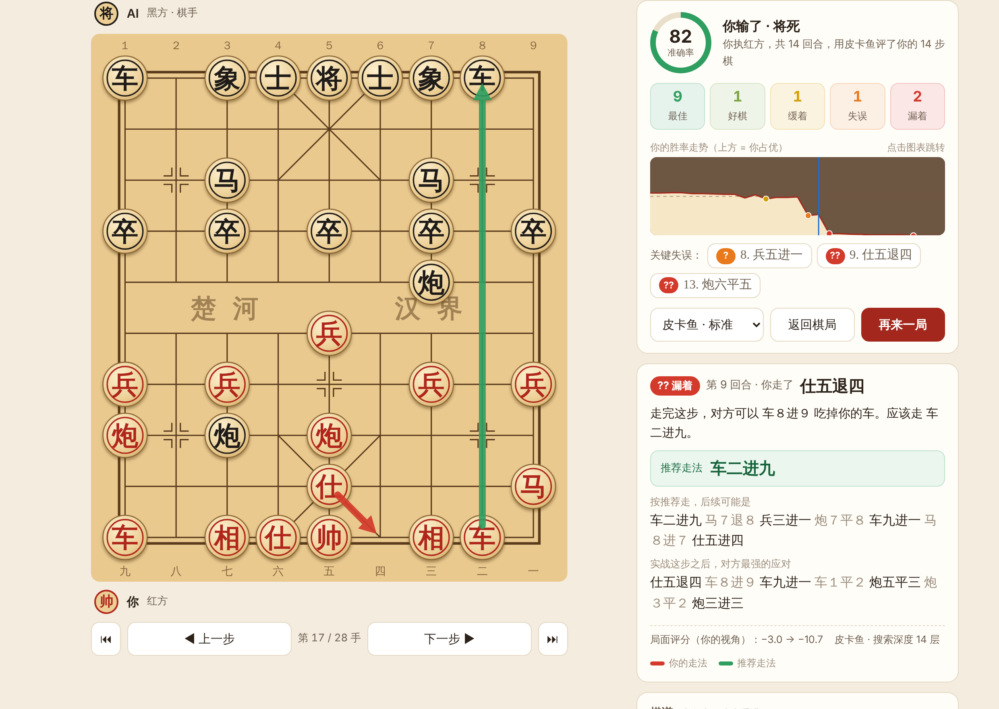
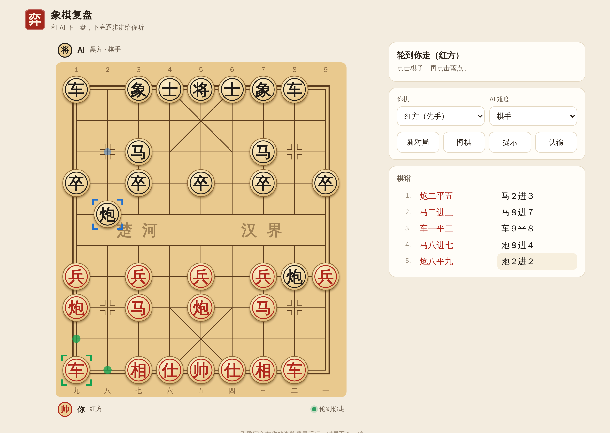

# 象棋复盘

和 AI 下一盘中国象棋，下完后逐步复盘：每一步下得好不好、为什么、应该怎么走。



纯前端静态网站，没有后端，也不需要任何 API Key —— 引擎直接跑在浏览器的 Web Worker 里。复盘默认使用开源引擎 [Pikafish（皮卡鱼）](https://github.com/official-pikafish/Pikafish) 的 WebAssembly 版本，另有一个用 JavaScript 写的内置引擎负责各档难度的对手。

## 功能

**对弈**

- 执红或执黑，六档 AI 难度：新手 / 入门 / 业余 / 棋手 / 大师（内置引擎），以及皮卡鱼（极强）
- 点击棋子显示所有合法落点，支持悔棋、提示、认输
- 中文纵线记谱（炮二平五、马８进７ ……）
- 完整规则：将帅不照面、困毙判负、长将判负、三次重复判和、六十回合无吃子判和
- 对局自动保存在浏览器本地，刷新不丢

**复盘**

- 对你走的每一步定级：★ 最佳 / ✓ 好棋 / ?! 缓着 / ? 失误 / ?? 漏着
- 给出推荐走法，并在棋盘上用箭头同时标出“你的走法”和“推荐走法”
- 文字讲解：丢了什么子、对方怎么吃、错过了什么杀棋或得子机会
- 两条变化对照：按推荐走的后续 vs. 实战这步之后对方最强的应对
- 整局准确率、各级着法统计、胜率走势图、关键失误一键跳转
- 复盘引擎可选：皮卡鱼（快速 / 标准 / 深入三档）或内置引擎，多线程并行分析
- 皮卡鱼首次使用时下载约 13 MB 的引擎文件；下载失败会自动退回内置引擎
- 键盘 ← → 翻看每一步



## 本地运行

需要通过 http 访问（浏览器不允许从 `file://` 启动模块化的 Worker）：

```bash
python3 -m http.server 8080
```

然后打开 <http://localhost:8080>。

## 部署到 GitHub Pages

仓库 Settings → Pages → Source 选择 `Deploy from a branch`，分支选 `main`、目录选 `/ (root)`，保存即可。没有构建步骤。

## 测试

```bash
npm test
```

测试覆盖：着法生成（perft 到 4 层，与公认数值 44 / 1920 / 79666 / 3290240 一致）、中文记谱、开局库合法性、杀棋搜索、长将检测、着法定级与讲解、皮卡鱼输出的解析与分数换算。

## 代码结构

| 文件 | 作用 |
| --- | --- |
| `js/engine.js` | 内置引擎：局面表示、着法生成、局面评估、搜索（迭代加深、PVS、置换表、空着裁剪、静态搜索、杀手/历史启发） |
| `js/worker.js` | 内置引擎的线程：AI 走棋、复盘分析 |
| `js/pikafish.js` | 皮卡鱼的封装：下载引擎文件、线程池、UCI 输出解析 |
| `js/pikafish-worker.js` | 皮卡鱼的引擎线程 |
| `vendor/pikafish/` | 皮卡鱼的预编译 WebAssembly 文件（第三方，来源和校验和见该目录的 README） |
| `js/review.js` | 着法定级、文字讲解、整局统计 |
| `js/notation.js` | 中文记谱 |
| `js/book.js` | 小型开局库 |
| `js/board.js` | SVG 棋盘 |
| `js/main.js` | 页面逻辑 |

## 复盘是怎么算的

对你走的每一步，引擎先在走子前的局面上搜索出最佳着法和评分，再评估你实际走的那一步走完之后的局面。两者的差距换算成“胜率损失”来定级；另外，白丢一个子以上的着法至少算失误（除非走完仍是必胜，或者局面本来就已无可挽回）。

讲解文字是根据引擎算出的两条主变化自动生成的（比较两条变化里的子力得失、是否有杀棋），不是大语言模型写的，所以战术上的问题（丢子、漏杀）说得比较准，纯粹位置上的优劣只能给出推荐走法和变化供对照。

## 已知局限

- 皮卡鱼用的是为网页和手机准备的小网络单线程版本，比桌面版的皮卡鱼弱，但仍然远强于内置引擎。每步只思考零点几秒到一两秒，复杂局面里的结论不是定论。
- 每个皮卡鱼线程要占用两百多 MB 内存，所以手机上只开一个线程，电脑上最多三个；长对局在手机上复盘会慢一些。
- 内置引擎是从零写的，普通电脑上 1 秒大约能搜 9–12 层，棋力有限，主要用来当不同难度的对手。
- 长捉等复杂的棋例没有实现，只判长将。

## 许可证

本项目以 [GNU GPL v3](LICENSE) 发布。`vendor/pikafish/` 里的 Pikafish 引擎同样是 GPL v3，版权归其作者所有，详见 [vendor/pikafish/README.md](vendor/pikafish/README.md)。
